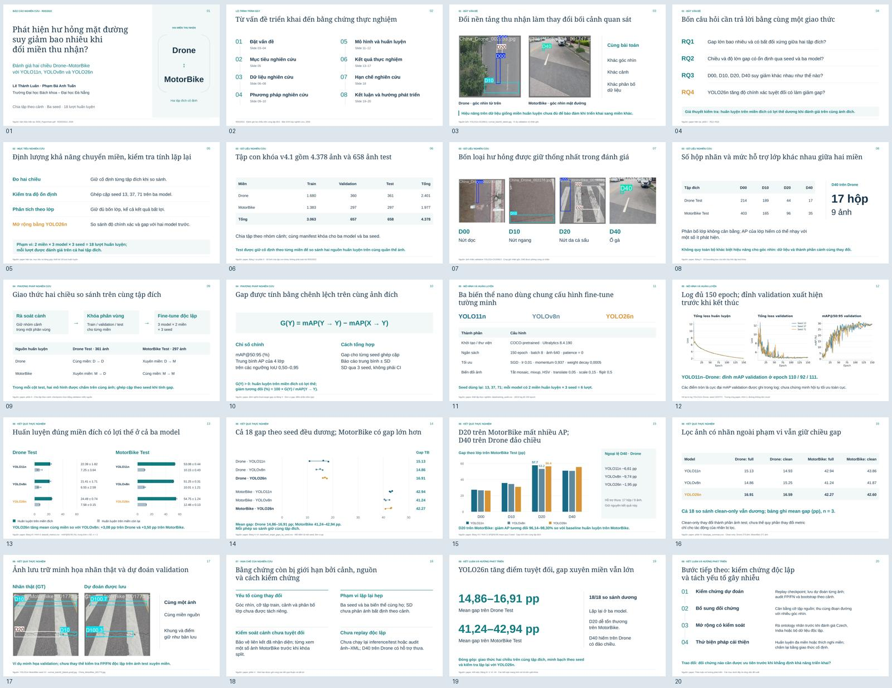

# Slide báo cáo RDD2022 bằng tiếng Việt

Bản trình bày gồm **20 slide / 8 phần**, theo cấu trúc `cau_truc.md` do tác giả cung cấp. Bản đầu tạo bằng `nature-paper2ppt`; bản hiện tại được thiết kế lại bằng **PPT Master 6.7.3**, nền sáng, tiêu đề Georgia và nội dung Arial, tông navy–teal. Giữ nguyên chữ, số liệu, thứ tự trang và toàn bộ ghi chú tiếng Việt của bản trước.

- [PowerPoint có thể chỉnh sửa](RDD2022_Bao_cao_Tieng_Viet.pptx)
- [PDF xem trước — 20 trang](RDD2022_Bao_cao_Tieng_Viet.pdf)
- [Ghi chú thuyết trình](ghi_chu_thuyet_trinh.md)
- [Kết quả kiểm tra bản xuất](verification.json)
- [Báo cáo kiểm tra và thay đổi thiết kế](qa_report.md)
- [Nguồn SVG có thể chỉnh sửa và quy chuẩn thiết kế](source/)

Nội dung và số liệu lấy từ [paper hiện tại](../../IEEE_Paper/) và các CSV đi kèm: YOLO11n, YOLOv8n, YOLO26n; hai miền Drone/MotorBike; ba seed 13, 37, 71; 18 lượt huấn luyện, mỗi lượt 150 epoch. Các biểu đồ chính và bảng dùng đối tượng PowerPoint có thể chỉnh sửa.

Phần mở rộng dùng kiểm tra clean-only có kết quả lưu trữ; Czech/India được trình bày trong hướng phát triển. Ảnh GT/dự đoán minh họa thuộc **validation của miền nguồn**, được ghi rõ trong slide, không được gọi là test xuyên miền. SD qua ba seed không phải khoảng tin cậy.

Đã kiểm tra đủ 20 slide, 20 trang PDF, 20 ghi chú; ZIP PowerPoint toàn vẹn; không mất token chữ khi xuất PDF. Audit cấu trúc cuối không có lỗi mức high/medium. Font Arial có thể hiển thị hơi khác tùy máy.
